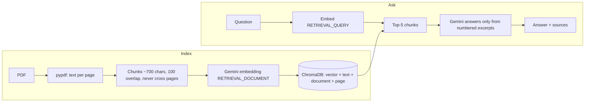

# notes-rag

[](https://github.com/HugoPello/notes-rag/actions/workflows/ci.yml)
[](LICENSE)
[](https://www.python.org/)

Chat with your class notes: a RAG app that answers questions from your PDFs and cites document and page. Python, FastAPI, ChromaDB, Gemini.

https://github.com/user-attachments/assets/84c4cba9-bfc3-4f3c-8c82-9f875c3a854c

## Features

- Upload your class PDFs from a small web UI (or the API).
- Ask questions in natural language.
- Answers come ONLY from your notes and cite document and page.
- If the notes do not cover the question, the app says "I don't know" instead of guessing.
- Re-uploading the same PDF is free: its SHA-256 is stored and identical files are not embedded again.

## How it works



## Tech stack

- Python 3.14 (3.11+ should work)
- FastAPI + uvicorn: HTTP API and static file serving
- ChromaDB: local persistent vector store
- google-genai: Gemini embeddings and answers
- pypdf: text extraction from PDFs
- Plain HTML/CSS/JavaScript: the web UI, no framework or build step
- pytest: tests
- Docker + Docker Compose: one-command run

## Quick start with Docker

```
copy .env.example .env
# edit .env and set GEMINI_API_KEY (get one in Google AI Studio)
docker compose up --build -d
```

Open http://127.0.0.1:8000 and upload a PDF.

- The container keeps its own index and PDFs in named volumes (`chroma_db`, `pdfs`), separate from your local `chroma_db/` and `data/`. `docker compose down` keeps them; `docker compose down -v` wipes them.
- The first build is slow (it downloads and installs the dependencies) and the image is large (about 875 MB on disk, 184 MB compressed content). Later builds reuse the cached dependency layer.

## Quick start (local)

Windows:

```
python -m venv .venv
.venv\Scripts\activate
pip install -r requirements.txt
copy .env.example .env
python -m uvicorn app.main:app --reload
```

Open http://127.0.0.1:8000. (Use `python -m uvicorn`: the `uvicorn.exe` launcher can be blocked on Windows.)

Console tools, with PDFs in `data/`:

```
python -m app.ingest                      # chunk, embed and store the PDFs (safe to re-run)
python -m app.store "your question"       # show the most similar chunks with document and page
python -m app.rag "your question"         # answer from your notes, with document and page
```

Note: if `EMBEDDING_DIM` in `app/embeddings.py` changes, delete `chroma_db/` and re-ingest.

## Configuration

`.env` only has `GEMINI_API_KEY`. It is git-ignored and never committed; `.env.example` has the empty variable.

## API

Interactive docs: http://127.0.0.1:8000/docs

| Method | Path | What it does |
|---|---|---|
| GET | `/health` | Liveness check |
| GET | `/documents` | Indexed documents with chunk counts |
| POST | `/documents` | Upload a PDF (multipart field `file`); chunks, embeds and indexes it |
| POST | `/ask` | JSON `{"question": "..."}`; answer with sources, or `found: false` ("I don't know") |

Uploading the same file twice is free: the SHA-256 of the PDF is stored in the index, and an identical
upload returns `"status": "unchanged"` without parsing or calling Gemini. Indexing with
`python -m app.ingest` does not store the hash, so the first API upload of a PDF re-embeds it once.

Errors: 400 empty/unnamed file, 409 nothing indexed yet, 413 file over 20 MB, 415 not a PDF,
422 unreadable PDF or no extractable text, 429 Gemini quota reached, 502 other Gemini errors,
503 `GEMINI_API_KEY` missing.

```
curl.exe http://127.0.0.1:8000/documents
curl.exe -F "file=@data/my-notes.pdf" http://127.0.0.1:8000/documents
curl.exe -X POST http://127.0.0.1:8000/ask -H "Content-Type: application/json" -d "@question.json"
```

where `question.json` contains `{"question": "How does Android store data?"}` (a file avoids
PowerShell quoting problems).

## Project structure

```
notes-rag/
  app/
    chunking.py     # pure function: pages -> page-aware overlapping chunks
    ingest.py       # read PDFs from data/, chunk, embed, store (python -m app.ingest)
    embeddings.py   # Gemini embeddings (documents vs queries), batching and retries
    store.py        # ChromaDB: save chunks, similarity search, list documents
    rag.py          # top-k retrieval + Gemini answer + sources (python -m app.rag)
    main.py         # FastAPI app: endpoints and serving the UI
    static/         # the web UI: index.html, style.css, app.js
  tests/            # pytest suite (no network, no API calls)
  data/             # your PDFs (git-ignored)
  Dockerfile        # image: Python slim, non-root user, healthcheck
  docker-compose.yml  # service, env file, named volumes, loopback-only port
```

## Technical decisions

- **pypdf**: pure Python and enough for text-based notes.
- **Chunks of 700 characters with 100 overlap**: 700 characters fit a paragraph or two; a ~15% overlap keeps sentences that straddle a cut; chunks are cut at a space so words are not split.
- **Page-aware chunks**: a chunk never crosses a page boundary, so every citation has an exact page.
- **`gemini-embedding-001`, 768 dimensions, cosine**: a good size/quality trade-off for a small corpus.
- **`RETRIEVAL_DOCUMENT` vs `RETRIEVAL_QUERY`**: the model embeds notes and questions differently on purpose, which improves matching.
- **`gemini-3.5-flash-lite` with minimal thinking**: cheap and fast; the retrieved context does the work, not the model's reasoning.
- **`NOT_IN_NOTES` code word instead of a similarity threshold**: scores cluster around 0.73, so a threshold is hard to justify. The model replies with the code word and the app turns it into "I don't know".
- **Sources built in Python from `[n]` citations**: the model only writes excerpt numbers, so it cannot invent a document or page.
- **SHA-256 skip on re-uploads**: on the free tier each embedded text counts as a request, so unchanged files are not re-embedded.
- **Plain JS with `textContent` only and CSP `default-src 'self'`**: text from PDFs and from the LLM is untrusted, so it is never inserted as HTML.
- **Sync endpoints**: the Gemini SDK and Chroma block, and FastAPI runs `def` endpoints in a threadpool, so the event loop is not blocked.
- **Docker**:
  - `python:3.14-slim`, not alpine, because the dependencies ship manylinux wheels.
  - `requirements.txt` is copied first so the install layer is cached.
  - The app runs as a non-root user.
  - Named volumes hold the SQLite-based index and the PDFs.
  - The port is bound to 127.0.0.1 because there is no authentication.
  - One worker, because Chroma's `PersistentClient` is not multi-process safe.

## Limitations and future work

- k=5 can miss pages in questions that span several documents.
- Scanned PDFs need OCR (not included).
- The "I don't know" message is always in English.
- The free-tier embedding quota is easy to exhaust when indexing many files.
- `python -m app.ingest` clears the stored hash, so the next API upload of that PDF re-embeds it once.
- A PDF removed from `data/` stays indexed (there is no delete endpoint).
- No authentication: run it locally only.
- Idea: conversation memory (send the last turns and rewrite the question before searching).

## Testing

```
pytest
```

Gemini is faked and Chroma uses temporary folders, so the tests make no API calls and need no network.

## Built with AI agents

This project was developed in phases with orchestrated Claude Code agents: an architect proposed designs,
an implementer wrote the code and tests, and a researcher checked documentation. I made the decisions,
chose between the alternatives and reviewed every phase before committing it. The workflow is documented in
[CLAUDE.md](CLAUDE.md), [.claude/agents/](.claude/agents/) and [PROJECT_STATUS.md](PROJECT_STATUS.md).

## License

MIT, see [LICENSE](LICENSE).
